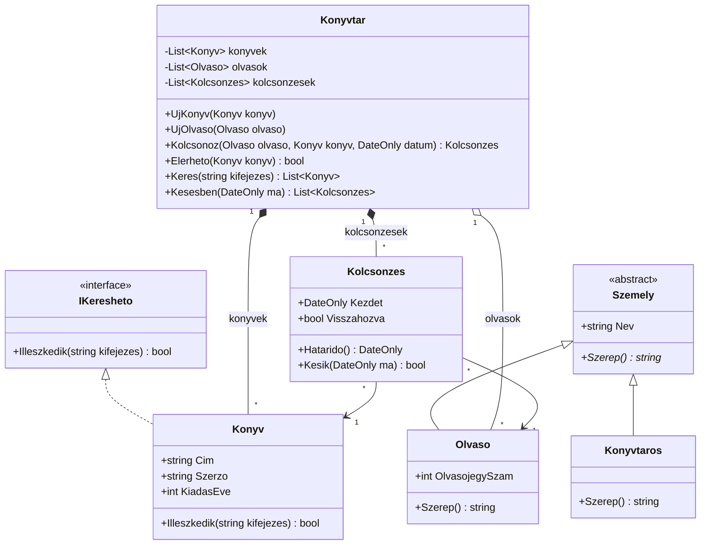

# 14-M05-L02 · Tiszta kód és UML

## Célok

A lecke végére a tanuló:

- megfogalmazza, miért fontos, hogy a kód könnyen olvasható legyen, és felsorolja a legfontosabb clean code elveket;
- beszédes neveket ad, rövid, egy feladatot végző metódusokat ír, és megszünteti az ismétlődést (DRY);
- egy működő, de rossz minőségű programot lépésenként refaktorál úgy, hogy a viselkedése ne változzon;
- elolvas egy UML-osztálydiagramot, és C#-kódot készít belőle;
- szöveges leírásból vagy meglévő kódból osztálydiagramot rajzol Mermaid-jelöléssel.

## Elmélet

### Miért számít, hogy „szép-e” a kód?

Egy programot egyszer írunk meg, de sokszor olvassuk: hibakereséskor, bővítéskor, vizsgán a saját kódunkat átnézve, csapatban a társunkét.
**Tiszta** (clean) az a kód, amelyet egy másik fejlesztő – vagy mi magunk fél év múlva – gyorsan megért. Ami érthető, az könnyebben módosítható is, és kevesebb hiba bújik meg benne.

A sietve, „csak működjön” alapon írt kód eleinte gyorsabb, de minden későbbi módosítás egyre drágább lesz – ezt hívják **technikai adósságnak**.
A legtöbb hiba ugyanis nem új kód írásakor, hanem meglévő kód módosításakor kerül a programba, mert a módosító nem látja át a következményeket.

### Elnevezés

| Szabály | Rossz | Jó |
|---|---|---|
| A név mondja meg, *mit* tárol / *mit* csinál | `d`, `x`, `lista2`, `Szamol()` | `dij`, `kedvezmenyesOsszeg`, `Vegosszeg()` |
| Metódus neve ige vagy igei kifejezés | `Adatok()` | `BeolvasCsvbol()`, `Kolcsonoz()` |
| Osztály neve főnév | `Feldolgoz` | `RendelesKalkulator` |
| Interfész neve `I`-vel kezdődik, a képességet írja le | `KonyvInterfesz` | `IKeresheto`, `ITermekRepository` |
| Ugyanarra a fogalomra mindig ugyanaz a szó | `Ar`, `Price`, `Osszeg` vegyesen | mindenhol `Ar` |
| Hosszú életű dolognak hosszabb név, ciklusváltozónak lehet rövid | | `for (int i ...)` rendben van |
| Ne kódold bele a típust a névbe | `strNev`, `intKor` | `nev`, `kor` |

C#-ban a szokásos írásmód: osztály, metódus, tulajdonság **PascalCase** (`KiadasEve`), helyi változó és paraméter **camelCase** (`kiadasEve`).
Visual Studióban az átnevezés **Ctrl+R, Ctrl+R** – minden előfordulást egyszerre ír át.

### Függvények (metódusok)

- **Legyen rövid, és csak egy dolgot csináljon.** Ha a nevéhez „és” kell (`BeolvasEsKiir`), akkor két metódus.
- **Egy szinten maradjon.** A fő metódus úgy olvasható, mint a szabály leírása; a részleteket kisebb metódusok végzik:
  ```csharp
  public decimal Vegosszeg(List<RendelesTetel> tetelek, string kuponKod, SzallitasiMod mod)
  {
      decimal kedvezmenyes = KedvezmenyLevonasa(Reszosszeg(tetelek), kuponKod);
      return Math.Round(kedvezmenyes + SzallitasiDij(kedvezmenyes, mod));
  }
  ```
- **Kevés paraméter.** Ha sok kell, valószínűleg összetartozó adatok – legyen belőlük osztály.
- **Ne legyen jelző (bool) paraméter.** A `Szamol(lista, kupon, true)` hívásnál senki nem tudja, mit jelent a `true`. Helyette két metódus vagy felsorolás (`SzallitasiMod.Hazhoz`).
- **Hibakód helyett kivétel.** A `return -1;` könnyen elfelejthető; az `ArgumentOutOfRangeException` nem.

### További elvek röviden

| Elv | Jelentése |
|---|---|
| **DRY** – *Don't Repeat Yourself* | Ugyanaz a tudás egy helyen legyen. Ha egy kódrészletet másolsz, emeld ki metódusba. Különben a módosításnál az egyik példányt elfelejted. |
| **KISS** – *Keep It Simple* | A legegyszerűbb működő megoldás a jó. Ne bonyolíts „hátha egyszer kell” alapon. |
| **Varázsszám helyett konstans** | `if (s < 15000)` helyett `if (osszeg < IngyenesSzallitasHatara)`. |
| **Egy felelősség** (*Single Responsibility*) | Egy osztálynak egy oka legyen a változásra – ez a rétegezés (14-M05-L01) alapgondolata is. |
| **Cserkészszabály** | Hagyd a kódot kicsit tisztábban, mint ahogy találtad. |
| **Komment** | A jó név többet ér a kommentnél. Kommentbe azt írd, amit a kód nem mond el (*miért* így), ne azt, amit elmond (`// végigmegyünk a listán`). A kikommentezett, régi kódot töröld. |
| **Kivételek** | Csak azt kapd el, amire értelmesen reagálni tudsz; üres `catch { }` blokk ne maradjon a kódban. |

### Refaktorálás

**Refaktorálás**: a kód belső szerkezetének javítása **a viselkedés megváltoztatása nélkül**. Kis lépésekben haladunk, és minden lépés után ellenőrizzük, hogy a program ugyanazt csinálja.
(Az ellenőrzést a következő leckében egységtesztekkel automatizáljuk.)

Előtte – egy webshop végösszeg-számítása (a [peldak/RefaktoralasWebshop](peldak/RefaktoralasWebshop/) `Elotte` mappájából):

```csharp
public double Szamol(List<string> l, string k, bool t)
{
    double s = 0;
    // végigmegyünk a listán
    foreach (var x in l) { var a = x.Split(';'); s = s + int.Parse(a[1]) * int.Parse(a[2]); }
    if (k == "TAVASZ10") { s = s - s * 0.1; }
    if (k == "HUSEG15")  { s = s - s * 0.15; }
    double sz = 0;
    if (t) { if (s < 15000) { sz = 1490; } }
    else   { if (s < 15000) { sz = 890; } }
    return Math.Round(s + sz);
}
```

Utána (`Utana` mappa, részlet):

```csharp
private const decimal IngyenesSzallitasHatara = 15000;
private const decimal HazhozSzallitasDija = 1490;
private const decimal CsomagpontDija = 890;

private static decimal SzallitasiDij(decimal osszeg, SzallitasiMod szallitasiMod)
{
    if (osszeg >= IngyenesSzallitasHatara)
        return 0;
    return szallitasiMod == SzallitasiMod.Hazhoz ? HazhozSzallitasDija : CsomagpontDija;
}
```

Mi változott? Beszédes nevek; konstansok a varázsszámok helyett; a `bool t` helyett `SzallitasiMod` felsorolás; a kuponok egy szótárban (új kupon = egy új sor);
a sorok feldolgozása külön (`RendelesTetel.Feldolgoz`); pénzhez `decimal` a `double` helyett; a fő metódus három rövid lépésre bomlik.
A program mindkét változattal kiszámolja ugyanazokat a rendeléseket, és kiírja, egyezik-e az eredmény.

Gyakori refaktorálási lépések Visual Studióban (**Ctrl+.** a kijelölésen): *Rename*, *Extract method*, *Introduce constant*, *Inline temporary variable*.

### UML-osztálydiagram

Az **UML** (Unified Modeling Language) szabványos, programozási nyelvtől független grafikus jelölésrendszer szoftverek tervezéséhez és dokumentálásához.
Kétféle diagramcsoportja van: a **szerkezeti** diagramok (pl. osztály-, komponens-, telepítési diagram) a rendszer felépítését, a **viselkedési** diagramok
(pl. használatieset-, aktivitás-, szekvencia-, állapotdiagram) a működését írják le. Mi az **osztálydiagrammal** foglalkozunk, mert ez áll legközelebb a kódhoz.

Egy osztály három rekeszből áll: **név**, **adattagok** (tulajdonságok), **műveletek** (metódusok).

| Jelölés | Jelentés | C# |
|---|---|---|
| `+` | publikus | `public` |
| `-` | privát | `private` |
| `#` | védett | `protected` |
| `+Kor(int evszam) int` | metódus paraméterrel és visszatérési típussal | `public int Kor(int evszam)` |
| `<<abstract>>`, dőlt név / `*` | absztrakt osztály / metódus | `abstract` |
| `<<interface>>` | interfész | `interface` |

Kapcsolatok:

| Kapcsolat | Mermaid | Jelentés | Példa |
|---|---|---|---|
| Öröklődés | `Szemely <\|-- Olvaso` | „az olvasó egy személy” | `class Olvaso : Szemely` |
| Megvalósítás | `IKeresheto <\|.. Konyv` | az osztály megvalósítja az interfészt | `class Konyv : IKeresheto` |
| Asszociáció | `Kolcsonzes --> Konyv` | ismeri, hivatkozik rá | `public Konyv Konyv { get; }` |
| Aggregáció | `Konyvtar o-- Olvaso` | „része”, de nélküle is létezik | lista, de az elemek máshol is élnek |
| Kompozíció | `Konyvtar *-- Konyv` | „része”, és vele együtt él/hal | a tároló hozza létre és birtokolja |

A **multiplicitás** megadja, hány objektum vesz részt a kapcsolatban: `1`, `0..1` (nem kötelező – C#-ban `?`), `*` vagy `0..*` (akárhány – lista), `1..*` (legalább egy).

### Mermaid: diagram a README-ben

A GitHub a ` ```mermaid ` kódblokkot diagramként jeleníti meg, így a terv a kód mellett, verziókezelve él. Kipróbálni és szerkeszteni a [mermaid.live](https://mermaid.live) oldalon lehet.
A [peldak/UmlKonyvtar](peldak/UmlKonyvtar/) projekt ennek a diagramnak a megvalósítása:



Tervezés szövegből: a leírás **főnevei** osztályjelöltek vagy tulajdonságok, az **igéi** metódusok; a „van neki”, „része” kifejezések kapcsolatot,
a „egyfajta”, „kétféle … van” kifejezések öröklődést sejtetnek.

### Tipikus hibák

- **Refaktorálás közben új funkció vagy hibajavítás**: ha közben a viselkedés is változik, nem tudod, melyik lépés rontott el valamit. Előbb refaktorálj, utána (külön) javíts.
- **Túl nagy lépések**: egyszerre átírt fél program után nehéz megtalálni a hibát. Kis lépés → futtatás → következő lépés.
- **Kommentben magyarázott rossz név**: `int d; // díj` – nevezd át `dij`-ra, és a komment fölösleges.
- **Rossz irányú öröklődési nyíl**: az üres háromszög mindig az **ősosztály** felé mutat.
- **A diagram és a kód eltér**: ha a kódban új metódus született, a diagramot is frissíteni kell.
- **Mermaid-szintaxis**: generikus típus `List~Konyv~` (nem `<` `>`), az ékezetes azonosítókat kerüld.

## Példák

| Projekt | Mit mutat be |
|---|---|
| [peldak/RefaktoralasWebshop](peldak/RefaktoralasWebshop/) | Ugyanaz a végösszeg-számítás „előtte” (`Elotte/Rsz.cs`) és „utána” (`Utana/`) változatban; a program kiírja, hogy a két eredmény egyezik |
| [peldak/UmlKonyvtar](peldak/UmlKonyvtar/) | A fenti osztálydiagram C#-megvalósítása: absztrakt osztály, öröklődés, interfész, aggregáció, kompozíció, asszociáció |

## Feladatok

| Azonosító | Feladat | Nehézség | Megoldás |
|---|---|---|---|
| 14-M05-L02-F01 | [Parkolóház – refaktorálás](feladatok/F01-refaktoralas/) | ★★☆ | [megoldás](megoldasok/F01-refaktoralas/) |
| 14-M05-L02-F02 | [Állatorvosi rendelő – diagramból kód](feladatok/F02-diagrambol-kod/) | ★★☆ | [megoldás](megoldasok/F02-diagrambol-kod/) |
| 14-M05-L02-F03 | [Edzőterem – tervezés UML-lel, majd megvalósítás](feladatok/F03-tervezes-uml-kod/) | ★★★ | [megoldás](megoldasok/F03-tervezes-uml-kod/) |

## Kapcsolódó

- Előző lecke: 14-M05-L01 (Rétegzett architektúra, tervezési minták)
- Következő lecke: 14-M05-L03 (Egységtesztelés)
- Tanmenet: [2-14](../../../tanmenet/2-14.md)
