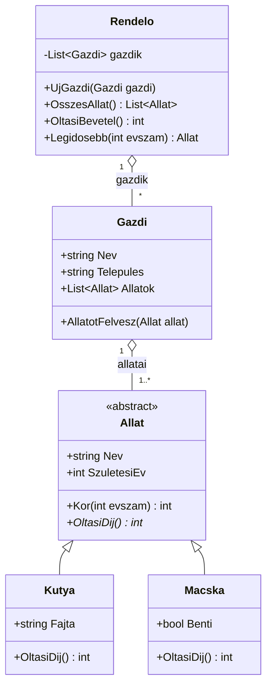

# 14-M05-L02-F02 · Állatorvosi rendelő – diagramból kód

**Nehézség:** ★★☆ **Becsült idő:** 45 perc

## Feladat

Valósítsd meg C#-ban az alábbi UML-osztálydiagramot egy `Allatorvos` nevű konzolos projektben.



Szabályok, amelyek nem látszanak a diagramon:

- `Kor(evszam)` = `evszam - SzuletesiEv`.
- Kutya oltási díja 6500 Ft. Macskáé 4500 Ft, ha benti, és 5500 Ft, ha kijár (kiegészítő oltás miatt).
- `OltasiBevetel()`: ha a rendelő minden állatot beolt, mennyi a bevétel.
- `Legidosebb(evszam)`: a legidősebb állat a megadott évben.

A `Program.cs` vegyen fel legalább 3 gazdit és 5 állatot (kutyát és macskát vegyesen), majd írja ki:
gazdinként az állatokat (fajjal és korral), a teljes oltási bevételt és a legidősebb állatot.

## Minta kimenet

```
Nagy Péter (Szeged)
  Bodri – kutya (puli), 7 éves, oltás: 6 500 Ft
  Cirmi – macska (benti), 3 éves, oltás: 4 500 Ft
...
Oltási bevétel: 29 500 Ft
Legidősebb: Bodri (7 éves)
```

## Tippek

- A dőlt betűs (a Mermaid-kódban `*`-gal jelölt) művelet absztrakt: `public abstract int OltasiDij();`, a leszármazottban `override`.
- A `+` publikus, a `-` privát tag. A `List~Allat~` a C#-ban `List<Allat>`.
- Az állat fajának kiírásához használhatod a típusvizsgálatot: `allat is Kutya k ? $"kutya ({k.Fajta})" : ...`, vagy – szebben – egy újabb absztrakt/virtuális metódust (`Leiras()`). Ha bővíted a modellt, rajzold be a diagramba is!
- A diagramot a [mermaid.live](https://mermaid.live) oldalon is szerkesztheted.

Megoldás: [../../megoldasok/F02-diagrambol-kod/](../../megoldasok/F02-diagrambol-kod/)
