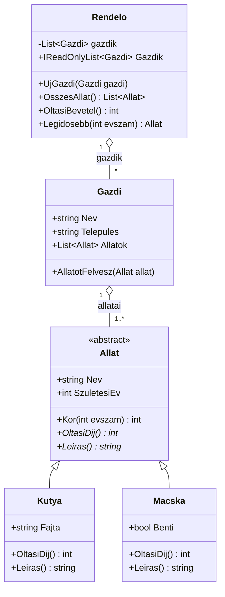

# Megoldás – 14-M05-L02-F02 · Állatorvosi rendelő

A megoldás a feladat diagramját követi, két kis bővítéssel, amelyeket a diagramba is berajzoltunk
(a kódban és a diagramban mindig ugyanannak kell szerepelnie):

- `Allat.Leiras()` absztrakt metódus – így a kiíráshoz nem kell `is Kutya` típusvizsgálat;
- `Rendelo.Gazdik` csak olvasható lista a kiíráshoz.

A `Legidosebb` a C#-ban `Allat?` típusú, mert üres rendelőben nincs legidősebb állat.
