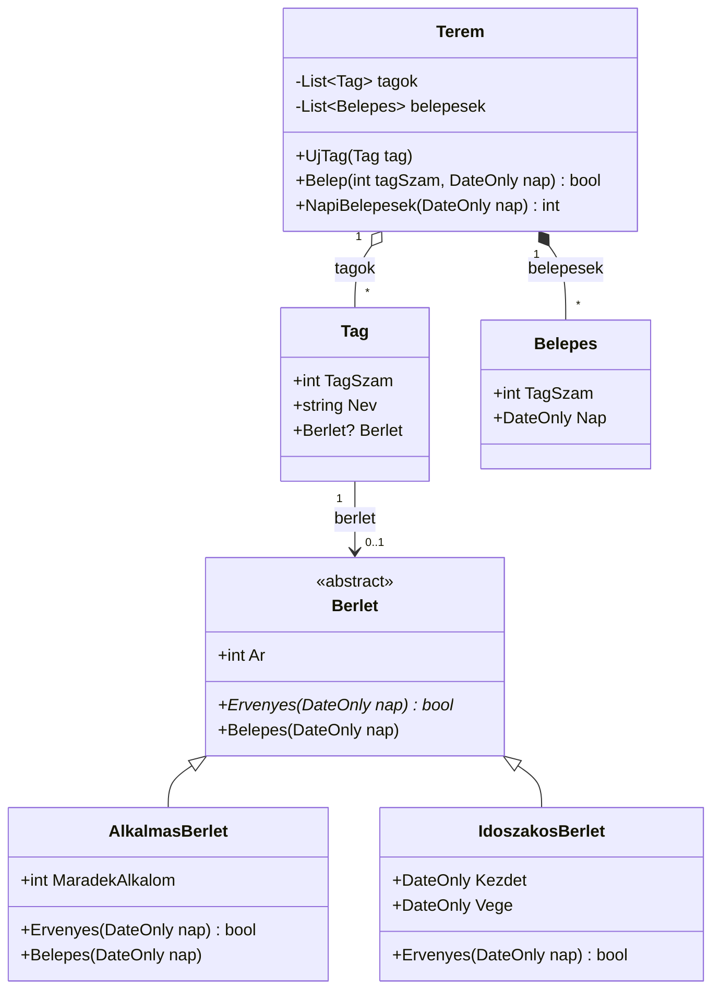

# Megoldás – 14-M05-L02-F03 · Edzőterem

## Osztálydiagram

## Döntések

- A `Belepes(nap)` az ősosztályban **virtuális**, üres törzzsel: csak az alkalmas bérletnek kell felülírnia.
- A belépések rögzítése kompozíció (`*--`): a `Belepes` objektumok a teremhez tartoznak, nélküle nincs értelmük. A tagok aggregáció (`o--`): a tag a terem nélkül is létező személy.
- A `Terem.Belep` először minden feltételt ellenőriz, és csak siker esetén módosít (alkalom levonása, rögzítés) – így sikertelen belépés nem hagy nyomot.
- Az osztály neve `Terem`, mert a projekt (és a névtér) neve már `Edzoterem`; azonos névtér- és osztálynév kellemetlen ütközést okozna.
